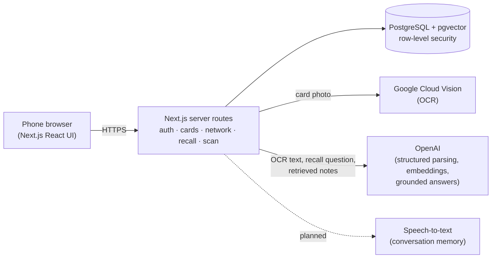

# Wasl technical solution

Draft for the product-market fit check (week of 2 November 2026). It explains how each step of the prototype flow works, what is already built, and what the mockup only simulates.

## In one paragraph

Wasl is a mobile-first web app (Next.js) backed by PostgreSQL. Each user has one private profile and several cards that show only the fields they choose. When two people swap cards, the receiver keeps a private snapshot plus the context of the meeting (event, place, time, tags, notes). AI is used in three narrow places: reading a business card, summarizing a recorded conversation, and finding people by description. Every AI answer must point to something the user actually saved, so recall never invents people or facts.

## Architecture

| Layer | Choice | Why |
|---|---|---|
| App | Next.js 16 + React 19, responsive web app | One codebase for phone and laptop. Opens from a link or QR code, so a new contact doesn't need to install anything to see a card. |
| Database | PostgreSQL with pgvector (PGlite locally, Supabase or any hosted Postgres in production) | Relational data for cards and connections, plus vector search for recall, in one place. |
| Auth | Email + password sessions handled by the app | Works now. Sign in with LinkedIn is not built (see risks). |
| OCR | Google Cloud Vision | Requested from IT on the tech requirements form. Reads printed business cards. The clickable mockup uses Tesseract.js, a free OCR that runs in the browser: the first scan downloads about 7 MB (about 5 seconds on 4G), later scans take under a second. Google Vision is more accurate on hard cards. |
| AI | OpenAI: `gpt-4o-mini` for parsing and grounded answers, `text-embedding-3-small` for recall | Cheap, fast, and supports structured outputs. Both are set by environment variables, so they can be swapped. |
| Hosting | Vercel (or any Node host) + hosted Postgres | The demo currently runs from Antony's laptop through a temporary tunnel. A hosted deployment is the next infrastructure step. |

## How each step works

Status key: **Built** = works in the MVP repo today. **Mockup** = shown in the clickable mockup (`public/mockup/index.html`) with sample data and not wired to the backend yet. **Planned** = designed, not started.

| Step | What the user sees | How it works | Status |
|---|---|---|---|
| 1 · Join | Scan your own card or import LinkedIn; the profile fills itself and levels up | Card photo → Google Vision OCR → `gpt-4o-mini` turns the text into fields → user reviews before saving. Level = share of profile fields filled. | Scanning your own card: works in the mockup with the phone camera (OCR in the browser); the real app uses the built Google Vision scanner from step 3. Levels: **Mockup**. LinkedIn import: **Planned** (API access uncertain) |
| 2 · Build | Switch each detail on or off (or tap it on the card); pick a color | Each card stores a list of profile fields it shows. Shared links only ever expose those fields. | Field selection: **Built**. Tap-on-card editor, colors and company logos: **Mockup** |
| 3 · Share | Stacked wallet; "Share card" first asks whether they have Wasl; one scan swaps cards with a buzz | Each card has a revocable share token shown as a QR code. Scanning it saves the card. A two-way swap = both phones scan or one phone confirms on the other. If they have no Wasl, scan their paper card: the mockup does this for real with the phone camera (or a photo), Tesseract.js OCR and an editable review. | QR share + save, and scanning someone else's card (Google Vision, reviewed before saving): **Built**. Wallet stack and two-way swap animation: **Mockup** |
| 4 · Save | "Wasl already knows where you met"; one-tap tags | On save, the phone suggests event, place and time from the calendar entry happening now and the current location. The user confirms, or taps Change to pick another event or place. Tags are stored on the connection. | Meeting context, categories: **Built** (typed in). Calendar + location suggestions: **Mockup** |
| 5 · Remember | Tap the mic and talk; Wasl keeps the key points | Both people consent on their phones → audio is transcribed → `gpt-4o-mini` writes 3–5 bullet points → the audio is deleted and only the text is saved as a private note. | Private notes and interaction history: **Built**. Recording + summary: works in the mockup with the browser's speech-to-text (key points picked by rules; the real build will use the AI model), **Planned** for the backend |
| Bonus · Debrief | Swipe through tonight's people | Lists connections saved during the current event. Swipe right = favorite, left = keep as a contact. | Favorites: **Built**. Swipe debrief: **Mockup** |
| 6 · Browse | Albums by event and company build themselves | Albums are saved filters (event, company, tag) over the user's connections, so they stay up to date with no sorting. | Search and categories: **Built**. Auto albums: **Mockup** |
| 7 · Search (recall by memory) | "the engineer who offered me an intro to her CTO" → Mariam, with the reason | Hybrid search: keyword matching plus pgvector similarity over each contact's saved context. The top candidates go to the model, which may only return a contact it was given and must quote the exact saved text that matches. If AI is unavailable, keyword results still work. Before an event, Recall can also list people you've met who are on its guest list (Mockup). In the mockup you can also ask by voice, and Recall searches what was said in recorded chats, the people you scanned, and names (even just a last name). | **Built** (keyword always; AI when an OpenAI key is configured) |

## Data model (built)

`users` → `cards` (which fields each card shows) → `shares` (revocable link and QR tokens) → `connections` (the receiver's private snapshot plus meeting context, category and favorite) → `interactions` (private notes and history) → `embeddings` (one vector per connection version, used for recall). Supporting tables: `sessions`, `usage_buckets` (AI rate limits) and `audit_events`.

## Privacy and safety

- **Selective sharing.** A card link exposes only the fields that card shows. Revoking a link stops future access but cannot erase what someone already saved. The app says this plainly.
- **Private by default.** Notes, tags and summaries belong only to the person who wrote them. Row-level security in Postgres plus server-side ownership checks keep one user from reading another's data (covered by tests).
- **Recording needs both people.** A recording starts only after both phones agree. Audio is not stored; only the text summary is kept. This answers the privacy concern raised in the 26 September discussion.
- **Grounded AI.** Recall answers must cite a saved quote from a contact the user owns. The model has no write access, and missing API keys never produce fake results.
- **Location and calendar** are read on the user's phone and saved to their own connection record only. They are never shared with the other person.

## What's left, in order

1. **Get API access** from IT (OpenAI key and Google Cloud Vision). Scanning and AI recall are built and waiting on keys.
2. **Host it properly** (Vercel + Supabase Postgres) so the link works when the laptop is off.
3. **Bring the mockup screens into the real app**: wallet stack, tap-to-hide editor, levels, albums.
4. **Conversation memory**: consent flow → transcription → summary → delete audio.
5. **Calendar and location suggestions** at save time.
6. **Swipe debrief** after an event.

## Risks and open questions

- **LinkedIn API approval is unlikely for a student app.** Card scanning and QR sharing cover the same need; LinkedIn import stays a nice-to-have.
- **Recording laws and comfort.** Both-party consent and deleting the audio reduce the risk. User testing should check whether people are comfortable using it at all.
- **AI cost and latency.** Small models and caching keep both low; we should measure real numbers once keys arrive.
- **Network effect.** Wasl is most useful when both people have it. A shared card still opens as a web page for people without an account, and they can save it into Wasl after signing up.

## Where things are

- Clickable mockup: https://antonygkoo.github.io/wasl-prototype/ (source: `public/mockup/index.html`). Card scanning uses the real camera. Open a step directly with `#step-1` … `#step-7` or `#step-bonus`. It has a **User test** mode that times six tasks and counts taps.
- Screenshots for slides: `docs/presentation/mockup-screens/`. Regenerate them with `node scripts/capture-mockup.mjs`.
- Walkthrough video: https://antonygkoo.github.io/wasl-prototype/walkthrough.mp4. Re-record it with `node scripts/record-walkthrough.mjs` (needs Chrome and ffmpeg).
- Working MVP: see the root `README.md`; operations and hosting are in `docs/OPERATIONS.md`.
