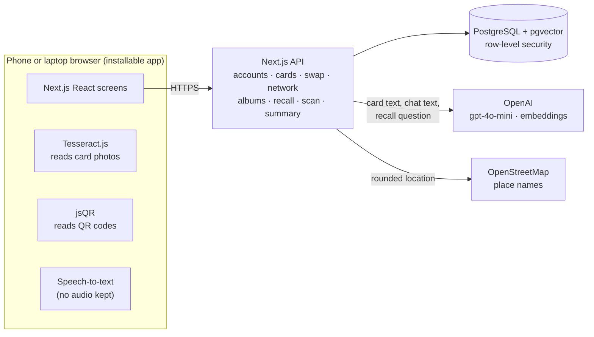

# Wasl technical solution

How each part of Wasl works in the real app (https://wasl-sable.vercel.app), as of 10 November 2026. The clickable mockup (https://antonygkoo.github.io/wasl-prototype/) shows the same flow with sample people.

## In one paragraph

Wasl is an installable web app (Next.js) backed by PostgreSQL. Each person has one private profile and several cards that show only the details they choose. When two people swap cards, each keeps a private copy plus the story of the meeting: where, when, tags, and what they talked about. AI is used in three narrow places: reading a business card, turning a recorded chat into key points, and finding people by what you remember. Every AI answer must point to something the person actually saved, and each feature still works with simple rules when AI is unavailable.

## Architecture

| Layer        | Choice                                                                                                                                | Why                                                                                                                                                                                                       |
| ------------ | ------------------------------------------------------------------------------------------------------------------------------------- | --------------------------------------------------------------------------------------------------------------------------------------------------------------------------------------------------------- |
| App          | Next.js 16, React 19, TypeScript; installable from the website (PWA); light and dark themes                                           | One codebase for phones and laptops. A card opens from a QR code or link, so the other person needs nothing installed to see it. Dark by default; light or the phone's setting can be picked in Settings. |
| Database     | PostgreSQL with pgvector: Supabase in production, PGlite locally                                                                      | Cards, connections and notes are relational; recall needs vector search. Both in one place.                                                                                                               |
| Security     | Row-level security on every user table, plus ownership checks on the server; salted scrypt passwords; revocable sessions; rate limits | One person can never read another's network, even through a bug in a query (tested).                                                                                                                      |
| On the phone | Tesseract.js (card text), jsQR (QR codes), the browser's speech-to-text, camera and location                                          | Photos and audio never leave the phone.                                                                                                                                                                   |
| AI           | OpenAI `gpt-4o-mini` with strict JSON output; `text-embedding-3-small`                                                                | Cheap and fast, and the output shape is checked before use.                                                                                                                                               |
| Hosting      | Vercel (Mumbai) + Supabase (Mumbai); every push to `main` redeploys                                                                   | Fast in Qatar, no servers to manage. A daily check keeps the free database awake.                                                                                                                         |

## How each step works

| Step             | What the person does                                                                                                                                           | How it works                                                                                                                                                                                                                                                                             |
| ---------------- | -------------------------------------------------------------------------------------------------------------------------------------------------------------- | ---------------------------------------------------------------------------------------------------------------------------------------------------------------------------------------------------------------------------------------------------------------------------------------- |
| 1 · Join         | Starts on the welcome page: scans their own business card (or gives their LinkedIn link, or uses email), signs up, and lands on a filled profile; adds a photo | The card is read on the phone, and the AI sorts the text into fields; the person checks every field before saving. The photo is made small and square on the phone before upload. A first Professional card is made at sign-up. A profile meter shows what's missing.                    |
| 2 · Build        | Makes cards for different crowds (Professional, Event, Social, Team) and switches each detail on or off                                                        | Each card stores the list of details it shows, and a live preview shows exactly what others will see. Shared links only ever expose those details.                                                                                                                                       |
| 3 · Share        | Shows a QR code. The other person scans it with the camera or inside Wasl, saves the card and sends theirs back in one tap.                                    | Each card has a revocable link. Saving it with "send my card too" creates the connection in both networks; the other side sees it marked New. People without Wasl can be invited by email, text or the phone's share sheet. QR codes printed on paper cards (vCard) become new contacts. |
| 4 · Save         | Confirms where they met and adds tags with one tap                                                                                                             | The event carries over from the last person saved that day; the place can come from the phone's location (a place name from OpenStreetMap, never shared with the other person). Tags are suggested (Hiring, Intro offered…) next to the person's own.                                    |
| 5 · Remember     | Both people agree, then the chat is written down and turned into key points                                                                                    | The browser's speech-to-text writes the words (no audio is recorded or kept). `gpt-4o-mini` picks the key points, or simple rules do if AI is unavailable. The person edits them before they are saved as a private note.                                                                |
| + Today's people | Swipes through everyone met today                                                                                                                              | Right = favorite, left = keep, mic = add a memory. Uses the same connections and favorite flag.                                                                                                                                                                                          |
| 6 · Browse       | Albums by event and company appear on their own; people make their own albums; group by event, company or tag                                                  | Event and company albums are worked out from the saved connections, so they never need sorting. Albums you make are stored on each person in them.                                                                                                                                       |
| 7 · Recall       | Types or says "the person who offered an intro to a CTO"                                                                                                       | Keyword search over saved values, plus vector similarity, makes a shortlist. The AI may only return people from that shortlist and must quote the exact saved text that matches; anything else is dropped. Without AI, keyword search still works.                                       |

## Data model

`users` → `cards` (which details each card shows) → `shares` (revocable link and QR tokens) → `connections` (your private copy of someone, with where you met, tags, albums, favorite, how they arrived, and a New marker) → `interactions` (private notes, including chat key points) → `embeddings` (one vector per connection version). Supporting tables: `sessions`, `usage_buckets` (rate limits) and `audit_events`. Migrations are in `db/`.

## Privacy and safety

- **Selective sharing.** A card link shows only that card's details. Revoking a link stops future access but cannot erase what someone already saved; the app says so.
- **Private by default.** Notes, tags, albums and key points belong only to the person who wrote them.
- **Recording needs both people.** Recording starts only after both agree. No audio is kept, only the edited text.
- **Grounded AI.** Recall must quote a saved line from a person you own. The model can't write anything, and missing keys never produce made-up results.
- **Location** is turned into a place name only when the person asks (or switches it on), and only rounded coordinates leave the phone.
- **Your data is yours.** Export everything as a file, change your password, or delete the account and everything in it from Settings.

## What a web app can't do yet

- Read the phone's calendar: browsers don't allow it, so Wasl carries the event over from the last person saved that day.
- Import from LinkedIn: needs an approved LinkedIn developer app, and it only shares name, email and photo.
- Reset a forgotten password by email: needs an email service and its key. Signed-in people can change their password.
- NFC tap and push notifications: need a native app. QR works on every phone today.
- Event guest lists ("who's going"): needs event partners.

## Where things are

- Live app: https://wasl-sable.vercel.app. Install it from its sign-in screen (or Add to Home Screen on iPhone).
- Clickable mockup: https://antonygkoo.github.io/wasl-prototype/ (source `public/mockup/index.html`), with a timed **User test** mode.
- Slide screenshots of the mockup: `docs/mockup-screens/` (`node scripts/capture-mockup.mjs`).
- Development plan from demo to product: `docs/DEVELOPMENT_PLAN.md`. Hosting and operations: `docs/OPERATIONS.md`.
